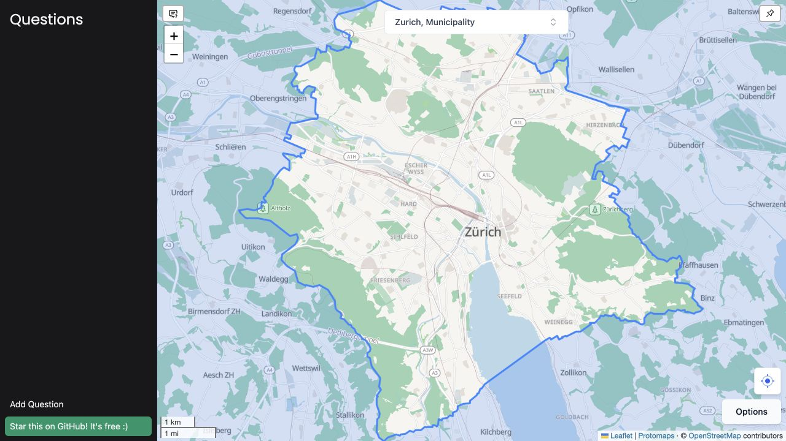

<h1 align="center">Jet Lag Hide and Seek — Switzerland</h1>

  

  
   
  <em>Zürich on the Swiss transit basemap</em>

### Download Swiss game data

For smoother play and faster question results, save the Swiss game data in your browser. In the live map, open **Options → Offline game data → Download Switzerland Data**. [See setup and coverage](docs/offline-game-data.md).

### Multiplayer question sync

Create or join a game from **Questions → Multiplayer**. Share the game code with everyone and the seeker PIN with seekers. Add a question, turn on **Sync**, collect the reply in WhatsApp, then enter the answer and lock the card. Both teams see the answer and lock. [See setup, deployment, and capacity](docs/multiplayer.md).

### Credits

This Switzerland-focused map is a fork of [taibeled’s JetLagHideAndSeek](https://github.com/taibeled/JetLagHideAndSeek).

[Buy the official Jet Lag Hide and Seek game on Nebula](https://store.nebula.tv/collections/jetlag/products/jet-lag-the-game-hide-and-seek-transit-game).
